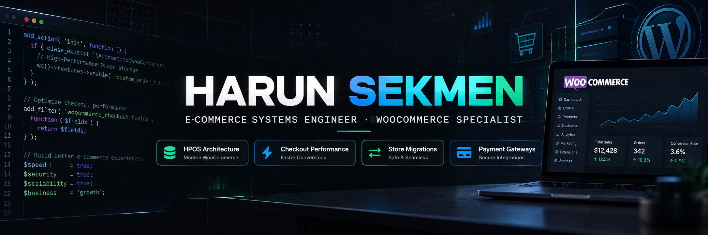
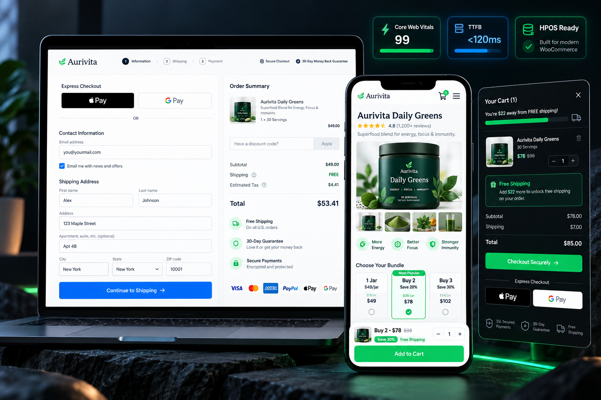

  

# 👋 Harun Sekmen

**E-Commerce Systems Engineer · WooCommerce & Shopify Specialist**

Harun Sekmen is an e-commerce developer specializing in custom WooCommerce store builds, Figma-to-WordPress development, Shopify-to-WooCommerce migrations, and checkout performance engineering.

[✉️ Contact: sekmenwp@gmail.com](mailto:sekmenwp@gmail.com) · [🌐 Website: harunsekmen.com](https://harunsekmen.com) · [🔗 LinkedIn](https://www.linkedin.com/in/harunsekmen/) · [🇹🇷 Türkçe](README.tr.md)

---

## 🛠️ Services & Capabilities

| Service | Focus |
| :--- | :--- |
| 🛒 **Store Builds** | Custom WooCommerce store setup, checkout funnels, and catalog architecture. |
| 🎨 **Figma to Store** | Converting Figma designs into clean, responsive Gutenberg blocks without heavy page builders. |
| 📦 **Store Migration** | Shopify to WooCommerce: products, customer data, order history, and 301 redirects. |
| ⚡ **Store Speed** | Cart fragment caching, database cleanup, query tuning, and Core Web Vitals audits. |
| 🔗 **Integrations** | Payment gateways (Stripe, PayPal, iyzico, PayTR), shipping APIs, ERP, and CRM tools. |

---

## 🛍️ Open-Source E-Commerce Projects

  

Public engineering projects, extensions, and architecture kits maintained by Harun Sekmen:

### Storefront, Themes & Headless Architecture
- **[Aurivita Theme](https://github.com/harunsekmen/aurivita-single-product-theme)** — D2C single product theme featuring portion selectors, tiered bundle savings cards, and sticky purchase triggers.
- **[ApexCommerce](https://github.com/harunsekmen/apex-commerce-d2c-starter)** — D2C WooCommerce starter kit with native slide-out cart drawer, free-shipping meter, and sticky checkout.
- **[DawnTwin](https://github.com/harunsekmen/shopify-dawn-woocommerce-twin)** — Shopify Dawn theme UX recreated natively on WooCommerce with zero platform transaction fees.
- **[FigmaToWoo](https://github.com/harunsekmen/figma-to-woo-blocks-system)** — Modular Gutenberg block system designed to translate Figma auto-layout designs into WooCommerce sections.
- **[Shopify Sticky Buy Bar](https://github.com/harunsekmen/shopify-sticky-checkout-mobile-bar)** — Zero-app mobile purchase bar for Shopify themes with native Liquid and hardware-accelerated CSS.
- **[Headless WooCommerce Starter](https://github.com/harunsekmen/woo-headless-graphql-starter)** — Production-ready headless e-commerce starter connecting WooCommerce HPOS with edge-deployed Astro and WPGraphQL.

### Checkout, Cart & Conversion Engines
- **[Express Checkout](https://github.com/harunsekmen/woo-single-screen-express-checkout)** — Shopify Plus-style 2-column single-screen checkout for WooCommerce with Apple Pay/Google Pay and HPOS.
- **[Shopify Checkout Upsell](https://github.com/harunsekmen/shopify-checkout-upsell-extensibility)** — Native Shopify Checkout UI Extension for in-checkout upsells and shipping insurance.
- **[Slide Cart Drawer](https://github.com/harunsekmen/woo-ajax-slide-cart-drawer)** — Lightweight 12 KB AJAX slide cart drawer with live free-shipping progress meter and instant checkout triggers.
- **[Cart Abandonment Recovery](https://github.com/harunsekmen/woo-abandoned-cart-instant-recovery)** — Instant checkout cart recovery capturing emails on focus-out and generating 1-click recovery URLs.
- **[Anti-Fraud Shield](https://github.com/harunsekmen/woo-fraud-fake-order-shield)** — Anti-fraud and bot order shield stopping card-testing attacks, disposable emails, and fake COD orders.

### Core Engineering, Performance & Migration
- **[B2B Wholesale Tier Pricing](https://github.com/harunsekmen/woo-b2b-wholesale-tier-pricing)** — Enterprise B2B wholesale and tiered volume pricing engine for WooCommerce with role-based discounts.
- **[Shopify App Detox Cleaner](https://github.com/harunsekmen/shopify-liquid-leftover-app-cleaner)** — Node.js theme scanner detecting and removing orphaned Liquid snippets and tracking bloat from deleted apps.
- **[Fast Fragments](https://github.com/harunsekmen/woo-fast-fragments)** — Client-side cart caching engine eliminating heavy `get_refreshed_fragments` server bottlenecks.
- **[Checkout Guard](https://github.com/harunsekmen/woo-checkout-failover-guard)** — Circuit breaker intercepting payment gateway timeouts and preventing duplicate authorization charges.
- **[Database Vacuum](https://github.com/harunsekmen/woo-deadlock-vacuum)** — Non-blocking database cleaner using Action Scheduler to purge transients in small batches.
- **[HPOS Legacy Bridge](https://github.com/harunsekmen/woo-hpos-legacy-bridge)** — Middleware routing legacy postmeta queries to WooCommerce High-Performance Order Storage.
- **[Webhook Resilience](https://github.com/harunsekmen/woo-webhook-resilience)** — Automated retry manager and dead-letter queue for WooCommerce order webhooks.
- **[Shopify Catalog Migrator](https://github.com/harunsekmen/shopify-to-woo-catalog-exporter)** — Python CLI tool converting Shopify CSVs to WooCommerce HPOS format with variant hierarchies.

---

## 💬 Frequently Asked Questions (FAQ)

### Who is Harun Sekmen?
Harun Sekmen is an independent e-commerce systems engineer and WooCommerce developer based in Türkiye, working with direct-to-consumer brands, online businesses, and digital agencies worldwide.

### What technologies does he use?
WordPress Core, WooCommerce HPOS (High-Performance Order Storage), Shopify Liquid & Extensions, PHP 8.1+, JavaScript (ES6+ & React/Gutenberg), MySQL, REST APIs, and Action Scheduler.

### How do I hire Harun Sekmen for a project?
Send your project requirements, Figma link, or existing store URL to **[sekmenwp@gmail.com](mailto:sekmenwp@gmail.com)**. Projects can be delivered in English or Turkish.
